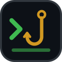

<div align="center">



# agent-base-kit

**Turn any check into a fail-closed PreToolUse hook for Claude Code and Codex. One function in, a verdict out. Zero dependencies.**

[](https://www.npmjs.com/package/agent-base-kit)
[](https://www.npmjs.com/package/agent-base-kit)
[](https://github.com/devmaxxx/agent-base-kit/actions/workflows/ci.yml)
[](https://www.npmjs.com/package/agent-base-kit)
[](./package.json)
[](./package.json)
[](./LICENSE)

[Install](#install) · [Quick start](#quick-start) · [Kinds](#kinds-and-matchers) · [Fail-closed](#the-fail-closed-contract) · [Install layout](#what-install-writes) · [Claude Code plugin](#shipping-as-a-claude-code-plugin) · [API](#api)

</div>

<details>
<summary><b>Table of contents</b></summary>

- [Why](#why)
- [Features](#features)
- [Install](#install)
- [Quick start](#quick-start)
  - [Why a devDependency](#why-a-devdependency)
- [Kinds and matchers](#kinds-and-matchers)
- [The fail-closed contract](#the-fail-closed-contract)
- [What install writes](#what-install-writes)
- [Shipping as a Claude Code plugin](#shipping-as-a-claude-code-plugin)
- [API](#api)
- [Design notes](#design-notes)
- [Contributing](#contributing)
- [License](#license)

</details>

## Why

A [PreToolUse hook](https://code.claude.com/docs/en/hooks) is the last point where you can stop an agent's tool call before it runs. Writing one well is mostly not about the check. The agents treat every exit except 2 as "go on", so a hook that crashes, cannot parse its input, or loses its Node.js after an upgrade lets every call through without a word.

agent-base-kit is that plumbing, for any guard you build. You write the check; it makes sure the check actually runs, and blocks when it cannot.

## Features

- **One function.** `check(call)` gets a typed call (`shell`, `write`, `edit` or `patch`) and returns `{ block, reason }`. Sync or async.
- **Fails closed.** Unreadable payloads, throws, bad verdicts, hangs and a hook that cannot start all block.
- **Both agents.** Claude Code and Codex, user or project scope, with matchers derived from the kinds you list.
- **Survives upgrades.** A user install runs its own copy of your build on the Node.js that installed it, so an nvm or Homebrew upgrade does not silently switch it off.
- **Plays well with other hooks.** Install and uninstall touch only their own entry and refuse a config they cannot extend safely.
- **Claude Code plugin files.** One call writes the manifest, `hooks.json` and a marketplace.
- **Zero dependencies**, ESM only, typed.

## Install

```sh
pnpm add -D agent-base-kit
# or: npm i -D agent-base-kit · yarn add -D agent-base-kit · bun add -d agent-base-kit
```

Requires Node.js 22 or later and a POSIX shell. It goes in `devDependencies`; [here is why](#why-a-devdependency).

## Quick start

A toy check that stops force pushes, as a plugin in three files:

```ts
// src/plugin.ts
import { defineHook } from 'agent-base-kit'

export const plugin = defineHook({
  name: 'no-force-push',
  kinds: ['shell'],
  statusMessage: 'Checking for force pushes',
  check: call => /\bgit\s+push\b.*\s(?:-f|--force)(?:\s|$)/.test(call.command)
    ? { block: true, reason: 'Blocked by no-force-push: push without --force, or use --force-with-lease.' }
    : { block: false },
})
```

```ts
#!/usr/bin/env node
// src/cli.ts
import { runCli } from 'agent-base-kit'
import { plugin } from './plugin'

void runCli(plugin, import.meta.url)
```

```jsonc
// package.json (the parts that matter)
{
  "name": "no-force-push",
  "type": "module",
  "bin": { "no-force-push": "./dist/cli.mjs" },
  "files": ["dist"],
  "engines": { "node": ">=22" },
  "devDependencies": {
    "agent-base-kit": "^0.1.0",
    "tsdown": "^0.23.1"
  }
}
```

Build `src/cli.ts` with tsdown. That gives you this CLI:

```sh
npx no-force-push install claude            # ~/.claude/settings.json
npx no-force-push install codex --project   # ./.codex/hooks.json
npx no-force-push uninstall claude
npx no-force-push hook                      # what the agent runs, with the tool call on stdin
```

### Why a devDependency

A user-scope install copies the `.mjs` files next to your bin into `~/.<name>/<build-id>/` and runs them from there. A runtime dependency would be imported from `node_modules`, and the copy has none. List agent-base-kit under `devDependencies` instead, and tsdown bundles it into your build. It also inlines its types into your `.d.mts`, so `export type { ToolCall } from 'agent-base-kit'` works for your users. If the copy cannot start anyway, `install` refuses and says why. It runs the copy once before writing any config.

## Kinds and matchers

`kinds` decides which calls reach your check. Each agent's matcher is derived from it.

| Kind | The call your check gets | Claude Code tools | Codex tools |
| --- | --- | --- | --- |
| `shell` | `{ kind: 'shell', command }` | `Bash` | `Bash` |
| `write` | `{ kind: 'write', path, content }` | `Write`, `NotebookEdit` | `apply_patch` |
| `edit` | `{ kind: 'edit', path, before, after }` (a MultiEdit's edits joined by newlines) | `Edit`, `MultiEdit` | `apply_patch` |
| `patch` | `{ kind: 'patch', patch }` (the whole patch text) | none | `apply_patch` |

`check` is typed to the kinds you list. It is never called with any other kind, even if a hand-written matcher sends one.

Codex sends every file change as one `apply_patch`. A plugin whose kinds include `write` or `edit` but not `patch` would match those calls and then never see them. So `install codex` refuses that plugin until you add `patch` and handle the patch text. A plugin with no tool in an agent, such as `['patch']` for Claude Code, is refused the same way.

## The fail-closed contract

The agents treat exit 2 as "block" and every other exit as "go on". So the hook exits 0 only when your check passes the call:

| What happens | Exit |
| --- | --- |
| `check` returns `{ block: false }` | 0 |
| `check` returns `{ block: true, reason }` (the reason goes to stderr as is) | 2 |
| `check` throws or rejects | 2 |
| `check` returns anything else: `undefined`, `{ block: true }` without a reason, a string | 2 |
| `check` returns a promise that never settles | 2 |
| The payload is not JSON, not an object, names no tool, or has a field of the wrong shape (a `command` sent as an array, `edits` as an object) | 2 |
| The tool is not one of your kinds | 0, and `check` is not called |
| The hook cannot start: Node.js is missing, the build was deleted, a dependency was not bundled | 2, from `\|\| exit 2` |
| The hook runs on a Node.js older than 22 | 2, with a message naming the fix |
| The hook times out | Claude Code blocks it (`onFailure: "block"`). Codex lets the call run. |

`check` may be async. Keep it well inside `timeout`, which defaults to 10 seconds. Past the timeout Codex runs the call unchecked.

## What install writes

The user scope is the default. Install copies the build to `~/.<name>/<build-id>/` and swaps the `~/.<name>/current` link onto it with a rename. Then it writes:

```sh
n='/path/to/the/installing/node'; [ -x "$n" ] || n=node; "$n" '/home/you/.<name>/current/cli.mjs' hook || exit 2
```

- The hook keeps running on the Node.js that installed it, so a project that pins an older Node does not change it.
- If that Node.js is removed, the hook falls back to the `node` on PATH.
- The copy outlives the package. An nvm upgrade or an `npx` cache clean does not remove it.
- The command stays the same across versions installed by the same Node.js, so Codex keeps trusting it.

`--project` writes `npx --no-install <packageName> hook || exit 2`, which is safe to commit.

Install replaces any entry it wrote before, including the older forms listed below, and keeps every other entry as it is. It refuses, and changes nothing, when:

- the settings file is not JSON, or not an object with a `hooks` object and a `PreToolUse` list (a `null` there counts as absent);
- `~/.<name>/current` exists and is not a link;
- the bin is not a built `.mjs` file;
- the copied build does not start.

Uninstall leaves the copy in place, since another agent may still run it.

In Claude Code the entry also sets `"onFailure": "block"`. That needs Claude Code 2.1.295 or later. Codex has no such field.

## Shipping as a Claude Code plugin

A Claude Code plugin needs no install step and no copy, because Claude Code keeps its own copy of the plugin. Generate the plugin files from your build, for example in tsdown's `onSuccess`:

```ts
// tsdown.config.ts
import { writeClaudePlugin } from 'agent-base-kit'
import { defineConfig } from 'tsdown'
import pkg from './package.json' with { type: 'json' }
import { plugin } from './src/plugin'

export default defineConfig({
  entry: ['src/cli.ts'],
  onSuccess() {
    writeClaudePlugin(import.meta.dirname, {
      plugin,
      entry: 'dist/cli.mjs',
      version: pkg.version,
      description: 'Stops force pushes',
      author: { name: 'you' },
      license: 'MIT',
      marketplace: { name: 'no-force-push', owner: { name: 'you' } },
    })
  },
})
```

This writes three files:

- `.claude-plugin/plugin.json` holds the manifest.
- `hooks/hooks.json` holds the hook: `node "${CLAUDE_PLUGIN_ROOT}/dist/cli.mjs" hook || exit 2`, with the matcher from `kinds`, your `timeout` and `statusMessage`, and `"onFailure": "block"`.
- `.claude-plugin/marketplace.json` is written only with `marketplace`. It is a one-plugin marketplace whose source is your npm package.

The build is not committed to git, and Claude Code copies a plugin as it is, without building it. So the marketplace fetches the plugin from npm, where `dist` is published. Add `.claude-plugin` and `hooks` to `files` in package.json, publish, and commit `.claude-plugin/marketplace.json` to the repository. Users then run:

```text
/plugin marketplace add you/no-force-push
/plugin install no-force-push@no-force-push
```

Use either the plugin or `install claude`, not both, or the check runs twice.

## API

```ts
function defineHook<const K extends ToolKind>(definition: HookDefinition<K>): HookPlugin
function runHook(plugin: HookPlugin, stdin: string, options?: { cwd?: string, stderr?: (text: string) => void }): Promise<number>
function createCli(plugin: HookPlugin, options?: { bin?: string }): (argv: readonly string[], io: CliIO) => Promise<number>
function runCli(plugin: HookPlugin, entryUrl: string, options?: { bin?: string }): Promise<void>
function readStdin(stream?: AsyncIterable<unknown>): Promise<string>
function install(options: InstallOptions): { file: string, command?: string }
function uninstall(options: UninstallOptions): { file: string }
function configFile(agent: Agent, scope: Scope, place: { home: string, cwd: string }): string
function matcherFor(agent: Agent, kinds: readonly ToolKind[]): string
function claudePluginFiles(options: ClaudePluginOptions): Record<string, string>
function writeClaudePlugin(dir: string, options: ClaudePluginOptions): string[]
```

`install`, `uninstall` and `createCli` take the home directory, the working directory, the bin path and the Node.js path as arguments, and never read them from the process. `runCli` is the one function that does, which keeps tests away from your real `~`.

## Design notes

- **Async checks.** A sync-only API would have to break later to allow I/O. A promise costs nothing now.
- **The reason is printed as is.** Your plugin owns its message, so start it with the plugin's name. Errors get a `Blocked by <name>, it could not check the call: …` prefix.
- **Which entries count as its own.** The `npx` form must match exactly. The pinned form matches any file under `~/.<name>/current/`, so a bin renamed between releases still replaces its old entry. The bare `node '<path>' hook` form from before the copy existed needs a directory named exactly after the plugin. So a hook that only mentions the plugin, or another plugin whose path merely contains this one's name, is never removed.
- **POSIX shells only.** Hook commands rely on `|| exit 2` and single-quoted paths, so Windows is not supported yet.

## Contributing

Issues and pull requests are welcome.

```sh
git clone https://github.com/devmaxxx/agent-base-kit.git
cd agent-base-kit
pnpm install
pnpm lint && pnpm typecheck && pnpm test
```

## License

[MIT](./LICENSE)
